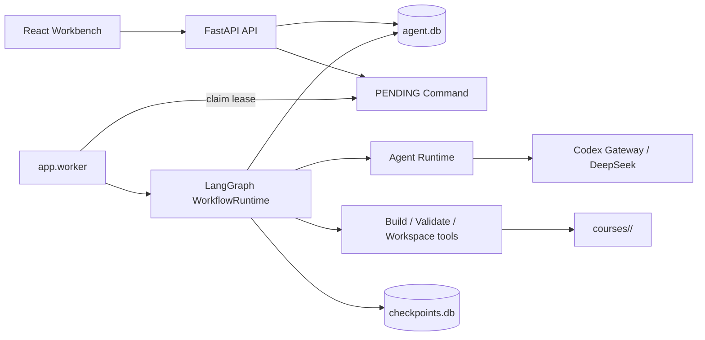

# AI Course Studio：后端与 Agent 技术设计

| 属性 | 内容 |
| --- | --- |
| 目录 | `apps/api/` |
| 技术栈 | Python 3.12、FastAPI 0.139、Pydantic 2、LangChain 1、LangGraph 1、SQLite、Uvicorn |
| Provider | 本地 Codex Gateway、DeepSeek、Fake Provider（测试） |
| 定位 | 课程生产领域内核、持久 Command/Worker、Agent Runtime 与质量闭环 |
| 关联 | [PRD](PRD.md) · [前端设计](FE-TD.md) |

## 1. 架构概览

后端将短 HTTP 请求与长课程生成拆开：FastAPI 负责校验、查询和提交 Command；独立 `app.worker` 从 SQLite 领取 Command；`WorkflowRuntime` 用 LangGraph 运行新课程或历史课程 Review 图；课程 Markdown 写入文件系统，业务运行数据与 LangGraph checkpoint 写入本地 SQLite。



## 2. 完整技术栈与工程结构

| 层 | 技术 | 作用 |
| --- | --- | --- |
| HTTP API | FastAPI + Pydantic | 路由、输入校验、OpenAPI、错误码 |
| Agent 编排 | LangGraph + sqlite checkpointer | 图执行、条件路由、`interrupt()`、失败恢复 |
| 模型调用 | LangChain、`langchain-deepseek`、Gateway adapter | 结构化输出、超时、Provider 能力适配 |
| 业务持久化 | Python `sqlite3` | Run、事件、Artifact、RepairTask、Command、Trace、预算 |
| 文件事实源 | 本地课程目录 | Workspace、Markdown、HTML、质量快照、课程资源 |
| 长任务 | 独立 `app.worker` 进程 | Command 租约、心跳、恢复、停止 |
| 可观测性 | Trace span、预算账本、运行事件 | 定位 Agent/工具耗时、Token 与错误 |
| 测试/规范 | pytest、Ruff、`fastapi` SKILL | 领域单测、API 契约、代码规范 |

```text
apps/api/app/
├── main.py / config.py / schemas.py / db.py
├── api/                    # course_routes、run_routes、system_routes
├── agents/                 # 协议、定义、真实运行时、Fake 运行时、Context
├── providers/              # Provider gateway 与协议
├── courses/                # catalog、scaffold、workspace、chapters、tools、quality
├── workflow/
│   ├── assembly/           # 新课程与 Review 图装配
│   ├── nodes/              # planning、generation、quality、repair、release、review
│   ├── services/           # Context Pack、批次、质量、修复、工作区契约
│   ├── command_repository.py / runtime.py / repository.py / snapshot.py
│   └── state.py            # LangGraph 状态类型
├── observability/          # trace、budget、执行上下文
└── worker.py               # 进程入口
```

## 3. 配置、Provider 与启动

`config.py` 以仓库根目录推导 `courses_root` 和 `.course-agent/`，从 `apps/api/.env` 读取配置。默认使用 Codex Gateway；也可切换 DeepSeek。关键配置包括 Provider/Model、超时、输出 token 上限、单章质量尝试次数、自动发现循环次数、Worker 轮询间隔与租约秒数。

`scripts/start-agent.sh` 会创建 `apps/api/.venv`，安装 `pyproject.toml` 声明的依赖，并分别启动 Uvicorn、Worker 和 Vite。API 和 Worker 是两个进程，但共享同一个 `.course-agent/agent.db`、`checkpoints.db` 和 `courses/`。

Provider 层必须吸收模型差异：不能假定每个模型支持相同的 `tool_choice`、thinking 模式或 JSON 输出。`CourseAgentRuntime` 通过 Pydantic schema 请求结构化结果；Humanizer 使用小范围补丁 schema，避免在 JSON 中返回整章长文。

## 4. API 设计

### 4.1 课程与 Workspace API

| Endpoint | 方法 | 请求 | 结果与规则 |
| --- | --- | --- | --- |
| `/api/courses` | GET | - | 扫描课程目录，返回课程与可恢复新建 Run |
| `/api/courses` | POST | `CourseCreate` | 创建脚手架、Run、intake Artifact，入队 `START` Command |
| `/api/courses/{slug}` | GET | - | 课程详情、课程质量快照和历史 Run |
| `/{slug}/workspace` | GET | - | 可见 Workspace 文件列表 |
| `/{slug}/workspace/file?path=` | GET/PUT | path；内容+`expected_hash` | 读取/原子保存，hash 冲突返回 `409` |
| `/{slug}/workspace/resources` | POST | 文件名、Base64、MIME | 安全写入 `workspace/resources/` |
| `/{slug}/workspace/resources/note` | POST | 文本 | 追加来源说明 |
| `/{slug}/chapters/{key}` | GET/PUT | ChapterUpdate | 读取/保存 Markdown；可选构建 |
| `/{slug}/assets/{path}` | GET | 课程内路径 | 只允许访问课程 `assets/` 下资源 |
| `/{slug}/tools/{action}` | POST | `build`/`validate` | 受控执行课程构建或校验脚本 |
| `/{slug}/runs` | POST | `RunStart` | 为 Review/重生成创建 Run 并入队 |

`CourseCreate` 约束 slug 为小写字母、数字和连字符；限制章节数、有效字符下限和 Token 预算。路径操作由课程模块校验为课程根目录的安全子路径，防止路径穿越。章节与 Workspace 保存基于内容 hash，并在覆盖前建立可恢复快照。

### 4.2 Run、系统与流式 API

| Endpoint | 方法 | 用途 |
| --- | --- | --- |
| `/api/runs?course_slug=` | GET | 列出 Run |
| `/api/runs/{id}` | GET | Run 主读模型：步骤、事件、Artifact、RepairTask、Command/Node timeline |
| `/api/runs/{id}/budget` | GET | Token、费用估算、阈值与违规投影 |
| `/api/runs/{id}/trace` | GET | Trace span 树 |
| `/api/runs/{id}/resolve` | POST | `APPROVE` / `REVISE` / `STOP`，入队 `RESUME` |
| `/api/runs/{id}/continue` | POST | 从失败 checkpoint 继续，或在人工暂停时发起修订/总结重建 |
| `/api/runs/{id}/stop` | POST | 标记活动 Command 取消并入队 `STOP` |
| `/api/runs/{id}/stream` | GET (SSE) | 每秒推送新增事件与状态 snapshot，终态后关闭 |
| `/api/health` | GET | Provider、模型、本地存储与 Gateway 可用性 |
| `/api/settings/provider` | PUT | 保存本地 Provider 偏好，不返回密钥 |
| `/api/workflow` | GET | 从可执行图导出的 UI 拓扑、Agent/Tool manifest |

所有长任务操作返回排队信息；审批只有在 Run 为 `WAITING_APPROVAL` 时可执行。发布批准还要求已有 release review，避免空摘要被误发布。

## 5. 数据库设计

`.course-agent/agent.db` 使用 SQLite。表分为业务记录、执行记录和观测记录：

| 表 | 核心字段 | 用途 |
| --- | --- | --- |
| `runs` | id、course_slug、status、current_step、provider、model、request_json | 一次课程生产或 Review 的当前状态 |
| `run_events` | run_id、seq、event_type、step、payload_json | 按序追加的可读运行历史，也是 SSE 来源 |
| `run_artifacts` | run_id、step、node、presentation_json、raw_output_json | UI 展示的模型/工具产物历史 |
| `artifacts` / `artifact_edges` | type、hash、storage URI、scope、父子边 | 版本化 Artifact 与血缘 |
| `chapter_versions` | course、chapter、hash、snapshot_path、reason | 手工修改前的章节快照 |
| `repair_tasks` | finding、证据、成功判据、状态、尝试数 | 可验证的定向修复工作项 |
| `repair_task_attempts` | task、轮次、阶段、验证 JSON | 修复尝试和验证历史 |
| `commands` | kind、payload、status、lease、heartbeat、cancel | API 与 Worker 间的持久队列 |
| `node_executions` | node、input_hash、status、lease、checkpoint_ref | 节点级幂等、复用和恢复 |
| `trace_spans` | trace、parent、kind、stage、duration、error | Command/Agent/Tool 调用时间线 |
| `budget_ledger_entries` / `budget_adjustments` | tokens、cost、duration、policy | Token/成本累计与预算策略变更 |

`commands` 以 `PENDING → LEASED/RUNNING → SUCCEEDED/FAILED/CANCELLED/WAITING_APPROVAL` 演进。Worker 用 SQLite `BEGIN IMMEDIATE` 领取下一条可用或过期租约的 Command；同一 Command 通过 `leased_by` 与租约续期避免重复处理。`node_executions` 对 `(run_id, node_id, input_hash)` 唯一：同输入已经成功的节点会复用，仍在有效租约中的节点返回 busy。

`checkpoints.db` 与业务库分离，由 LangGraph `SqliteSaver` 管理。它保存图恢复所需状态，不替代用户可读 Run、事件或课程正文。

## 6. Command、Worker 与恢复链路

```text
HTTP 写操作
→ create/enqueue Command(PENDING)
→ Worker claim_next_command(LEASED)
→ 建立 Trace/ExecutionContext，续租并运行图
→ 节点写 Event、Artifact、课程文件与 checkpoint
→ WAITING_APPROVAL / SUCCEEDED / FAILED / CANCELLED
```

Worker 对 `START` 执行新图或 Review 图；`RESUME` 以 `Command(resume=payload)` 恢复人工中断；`CONTINUE` 从最近失败 checkpoint 重放；`STOP` 立即把 Run 置为 `STOPPED`，其他执行则在安全边界检查 `cancel_requested`。这使 API 重启、Worker 异常或模型调用失败后仍可从持久状态继续，而不需要重新创建课程。

## 7. Agent Runtime、SKILL 与 Context Pack

`agents/protocols.py` 规定任务定义、蓝图、研究、章节生成、Humanizer、语义审校、连续性提取和修复的输入/输出协议；`FakeCourseAgent` 为测试提供确定性替身；`CourseAgentRuntime` 调用真实 Provider。

两个核心 SKILL 进入运行时的方式不同于“安装一个插件”：

- `teach-generator` 是课程领域规范。它约束 Mission、课程规格、蓝图、来源、教学结构、有效内容和语义质检；任务/蓝图/修复 Prompt 明确要求遵循它。
- `humanizer-zh` 是中文学生正文的独立语言门。Humanizer 只返回可精确匹配的补丁，不修改代码块、URL、数字、术语标记或标题结构；分数低于 `45/50` 即不通过。

章节生成不传递整段聊天记录。`workflow/services/context_packs.py` 按需组装课程约束、模块、当前章节、相邻章节摘要、continuity ledger、已批准资料和当前反馈，并把 Context Pack 与章节进度持久化到课程 Workspace。

## 8. LangGraph Workflow 设计

### 8.1 两张可执行图

- **new_course 图**：从 Mission 到发布，服务新课程创建。
- **review_course 图**：检查已有课程、输出 Review、人工确认后结束，服务课程审阅/局部重生成。

前端的七个阶段保持稳定：`intake → mission → blueprint → batch_plan → generation → quality → release`。`intake` 在 API 创建 Run 时完成；资料检索作为 blueprint 阶段的节点。图拓扑由 `workflow/snapshot.py` 直接导出给 UI，避免维护第二套手写流程图。

### 8.2 新课程关键节点与路由

| 阶段 | 节点 | 执行方式 | 结果/路由 |
| --- | --- | --- | --- |
| mission | `draft_mission` → `approve_mission` | LLM → interrupt | 人工批准、修改或停止 |
| mission | `revise_workspace` | Agent + 原子 patch | 增量修改任务/规格，再审计 |
| blueprint | `research_sources`、`draft_blueprint` | LLM | 来源计划与模块/章节蓝图 |
| blueprint | `verify_workspace_contract` | 确定性/审校 | 通过后审批蓝图，不通过记录重试并同步全局要求 |
| batch_plan | `plan_batches` → `approve_plan` | 确定性 → interrupt | 按模块边界分批，人工确认 |
| generation | `generate_batch` | Writer + Reviewer + 工具 | 章节生成、语言/语义/连续性、结构/构建校验 |
| generation | `repair_batch_chapters` / `request_batch_review` | Repair + interrupt | 定向修复或升级人工 |
| quality | `prepare_course_quality_review`、`course_quality_review` | 审校 + 工具 | 汇总全课 Finding，进入修复或发布审阅 |
| quality | `repair_open_chapters` | Repair + 工具 | 逐项最小修复、非回归验证 |
| release | `prepare_release_review` → `release_approval` | 系统 → interrupt | 用户发布、继续修复或停止 |
| release | `finalize` / `stop` | 系统 | 同步课程状态并结束 Run |

人为判断点使用 LangGraph `interrupt()`；节点开始、完成、失败与等待都会写入事件和 Artifact。模型不自行决定越过审批、扩大修复范围或无限循环。

## 9. 质量闭环与 RepairTask

单章生成链路为：

```text
Writer 生成 Markdown
→ 先落盘 lessons/
→ Humanizer（score ≥ 45）
→ 语义/事实审校（decision = ready）
→ 连续性提取
→ Source Contract
→ 批次静态构建
→ teach-generator validate-course
```

质量模块把失败归一为 RepairTask：其中包含章节/路径、严重度、证据、成功判据、尝试次数和验证结果。修复优先采用格式修复、链接/参考资料修复、局部文本 patch、内容补足或小节重写；修复候选需通过相同专项门和非回归检测，否则原子恢复修改前 Markdown。质量循环对同类 blocker 有预算，连续三轮仍无法收敛时暂停并交给人工。

## 10. 文件、构建与安全边界

课程模块只能在 `courses/<slug>/` 内读写。课程结构为：

```text
courses/<slug>/
├── workspace/       # MISSION、RESOURCES、规格、蓝图、Context Pack
├── lessons/         # Markdown 正文事实源与生成 HTML
├── reference/       # 术语与参考资料
├── markdown/        # 课程源/兼容内容
├── assets/          # 课程页面 CSS/JS/图片
└── quality/         # 质量快照与批次记录
```

`courses/tools.py` 只允许受控工具：`course.source_contract`、`course.build`、`course.validate`。构建调用 `scripts/build-static-course.mjs`，确定性课程校验调用 `.agents/skills/teach-generator/scripts/validate-course.mjs`。模型不能执行无限制 Shell、访问仓库外路径或直接发布到公网。

## 11. 验证、调试与推荐阅读顺序

```bash
apps/api/.venv/bin/python -m pytest apps/api/tests
npm --prefix apps/web run build
npm run test:contract
```

建议按以下顺序阅读：

1. `config.py`、`main.py`、`schemas.py`：启动、配置与 API 输入。
2. `api/course_routes.py`、`api/run_routes.py`：一次用户操作如何进入系统。
3. `workflow/command_repository.py`、`worker.py`：持久 Command、租约、恢复与停止。
4. `workflow/assembly/`、`workflow/nodes/`、`workflow/snapshot.py`：图、节点和 UI 投影。
5. `agents/course_runtime.py`、`providers/`：模型调用与结构化输出。
6. `workflow/services/`、`courses/`：Context Pack、质量、文件写入、构建与校验。

调试时先读取 Run 事件、active Command、当前 NodeExecution 和 Trace，再查看课程 Workspace/Markdown 与 Artifact。不要仅凭某个 HTML 或数据库字段存在就判断整次 Run 成功。
